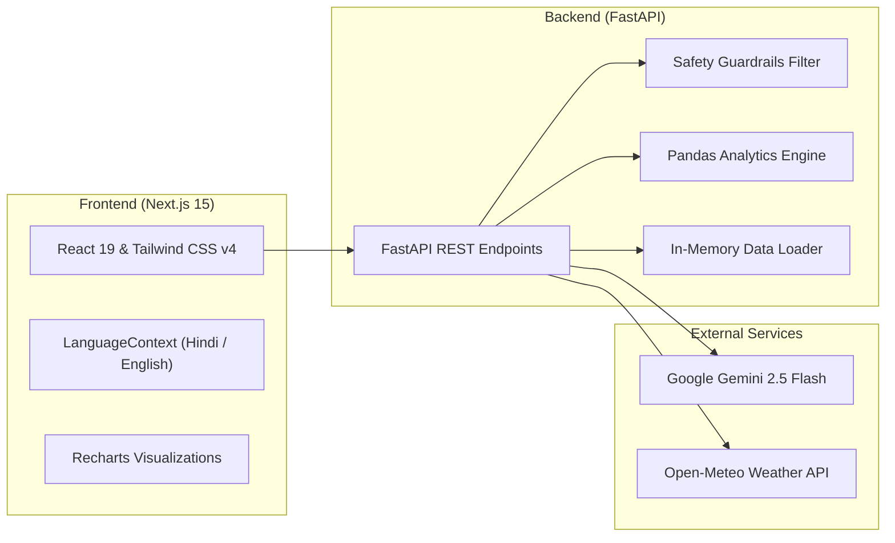

# 🌱 Annadata AI (अन्नदाता AI)

> **Empowering Indian Farmers with Multilingual, Responsible Agro-Intelligence**  
> *भारतीय किसानों के लिए आधुनिक, सुरक्षित एवं सुलभ डिजिटल कृषि सलाहकार।*

---

## 📌 Overview

**Annadata AI (अन्नदाता AI)** is an intelligent agricultural advisory platform engineered specifically for smallholder and rural farmers in India. Built with **FastAPI** on the backend and **Next.js 15** on the frontend, Annadata AI bridges the gap between state-of-the-art Generative AI and ground-level farming realities.

The platform provides actionable, weather-aware, and market-driven agricultural insights through an intuitive, bilingual (Hindi & English) interface with voice support—prioritizing farmer safety through strict **Responsible AI guardrails**.

---

## 🌟 Key Features

### 🌿 1. Crop Disease Detection & Vision AI
- **Image-Based Diagnosis:** Upload or snap pictures of affected crop leaves (Tomato, Potato, Wheat, Rice, etc.).
- **Grounded AI Analysis:** Powered by **Google Gemini Vision AI (`gemini-2.5-flash`)**, cross-referenced against an authoritative crop disease knowledge base.
- **Symptom-Based Text Diagnosis:** Alternative fallback allowing farmers to describe visible symptoms in plain words.
- **Safe First Steps:** Delivers organic and preventive first-aid actions (leaf pruning, irrigation adjustment, sunlight aeration).
- **Hazardous Chemical Prevention:** Explicitly bans and filters hazardous pesticide dosage prescriptions, routing farmers to verified **Krishi Vigyan Kendras (KVK)**.

### 📈 2. Mandi Intelligence & Price Analytics
- **Market Price Discovery:** Real-time and historical modal, minimum, and maximum prices across key agricultural markets (e.g., Patna, Hajipur, Muzaffarpur, Ara, Bihar Sharif).
- **Trend Visualizations:** Interactive 7-day and 30-day price trend charts powered by **Recharts** and **Pandas**.
- **Actionable Decision Support:** Data-backed *"Sell Now or Wait"* (बेचें या प्रतीक्षा करें) recommendations based on moving averages and arrival volumes.
- **Nearby Mandi Comparison:** Cross-mandi price spreads to help farmers choose the most profitable selling destination.

### 🌦️ 3. Weather-Aware Spray Advisory
- **48-Hour Rainfall Forecasting:** Analyzes precipitation forecasts to prevent costly pesticide and fertilizer wash-off.
- **Smart Spray Rules:**
  - **Precipitation > 2 mm:** Issues strict cautionary warning against spraying to avoid runoff waste.
  - **Precipitation ≤ 2 mm:** Provides cautious advisory based on humidity, temperature, and wind speed.
- **Hybrid Source Support:** Integrates with the live **Open-Meteo API** with fallback to offline local meteorological samples.

### 🤖 4. Multilingual Farmer Assistant
- **Conversational Intelligence:** Answers natural farming queries in **Hindi (हिंदी)**, **Hinglish**, and **English**.
- **Integrated Voice Support:** Speech-to-Text and Text-to-Speech capabilities designed for low-literacy accessibility.
- **Holistic Context:** Automatically correlates weather forecasts, crop health advisories, and market prices in answers.

### 🛡️ 5. Responsible AI Guardrails & Disclaimers
- **Strict Chemical Filter:** Automatically scans and redacts unauthorized chemical names (e.g., Chlorpyrifos, Phorate, Paraquat) and dosage patterns (e.g., `2 ml/L`, `500 gm/acre`).
- **Mandatory KVK Referral:** Requires farmers to consult certified agricultural officers or local KVKs for chemical treatments.
- **Transparent Disclaimers:** Clear synthetic data flags and probabilistic disease detection alerts.

---

## 🏗️ Architecture & Tech Stack



### Backend
- **Framework:** FastAPI (Python 3.10+)
- **Data Processing:** Pandas, NumPy
- **AI & Vision:** Google GenAI SDK (`google-genai`), Gemini 2.5 Flash
- **Data Validation:** Pydantic v2
- **Testing:** Pytest, AnyIO

### Frontend
- **Framework:** Next.js 15 (App Router)
- **UI Library:** React 19, Tailwind CSS v4
- **Icons:** Lucide React
- **Data Visualization:** Recharts
- **Internationalization:** Context-based bilingual engine (Hindi / English / Hinglish)

---

## 📁 Repository Structure

```text
Annadata_AI/
├── backend/
│   ├── data/                   # Data loader & dataset schemas
│   │   ├── loader.py           # In-memory singleton caching & validation
│   │   └── __init__.py
│   ├── schemas/                # Pydantic request & response models
│   │   ├── models.py
│   │   └── __init__.py
│   ├── services/               # Core domain service implementations
│   │   ├── assistant_service.py # Multilingual NLP & query router
│   │   ├── disease_service.py   # Gemini Vision AI & leaf diagnostics
│   │   ├── mandi_service.py     # Pandas price trends & calculations
│   │   ├── weather_service.py   # Open-Meteo & spray advisory logic
│   │   └── __init__.py
│   ├── tests/                  # Pytest automated test suite
│   │   ├── test_disease_detection.py
│   │   ├── test_foundation.py
│   │   ├── test_mandi_intelligence.py
│   │   └── test_weather_advisory.py
│   ├── utils/                  # Safety filters & helper utilities
│   │   ├── safety.py           # Chemical redaction & KVK guardrails
│   │   └── __init__.py
│   ├── .env.example            # Backend environment template
│   ├── .gitignore              # Python gitignore configuration
│   ├── app.py                  # Uvicorn entrypoint alias
│   ├── main.py                 # FastAPI application setup & routes
│   └── requirements.txt        # Python package dependencies
│
├── frontend/
│   ├── public/                 # Static assets & illustrations
│   ├── src/
│   │   ├── app/                # Next.js App Router pages & API routes
│   │   │   ├── layout.tsx      # Root layout
│   │   │   ├── page.tsx        # Main dashboard container & tab navigation
│   │   │   └── globals.css     # Tailwind styles
│   │   ├── components/         # Modular tab views & UI components
│   │   │   ├── HomeTab.tsx     # Landing dashboard & quick actions
│   │   │   ├── DiseaseTab.tsx  # Vision leaf scanner & symptom checker
│   │   │   ├── MandiTab.tsx    # Mandi price charts & recommendations
│   │   │   ├── WeatherTab.tsx  # Weather forecast & spray feasibility
│   │   │   ├── AssistantTab.tsx# AI voice & text chat assistant
│   │   │   └── AboutTab.tsx    # Mission, safety & KVK contacts
│   │   ├── context/            # Global application state
│   │   │   └── LanguageContext.tsx # Bilingual state management
│   │   └── data/               # Offline fallback samples & mock caches
│   ├── .env.local              # Local Next.js environment configuration
│   ├── .gitignore              # Node & Next.js gitignore configuration
│   ├── package.json            # Node.js dependencies & scripts
│   ├── tsconfig.json           # TypeScript configuration
│   └── next.config.ts          # Next.js configuration
│
├── .gitignore                  # Root gitignore
└── README.md                   # Project documentation
```

---

## 🚀 Getting Started

### Prerequisites
- **Python:** 3.10 or higher
- **Node.js:** 18.18+ or 20+
- **npm** or **pnpm** / **yarn**
- **Google Gemini API Key** (Get one at [Google AI Studio](https://aistudio.google.com/))

---

### 1. Backend Setup

1. **Navigate to the backend directory:**
   ```bash
   cd backend
   ```

2. **Create and activate a virtual environment:**
   ```bash
   # Windows (PowerShell)
   python -m venv venv
   .\venv\Scripts\Activate.ps1

   # Linux / macOS
   python3 -m venv venv
   source venv/bin/activate
   ```

3. **Install dependencies:**
   ```bash
   pip install -r requirements.txt
   ```

4. **Configure environment variables:**
   Copy `.env.example` to `.env`:
   ```bash
   cp .env.example .env
   ```
   Edit `.env` and set your Gemini API key:
   ```env
   GEMINI_API_KEY=your_actual_gemini_api_key_here
   PORT=8000
   HOST=0.0.0.0
   ```

5. **Start the FastAPI backend:**
   ```bash
   uvicorn app:app --reload --port 8000
   ```
   - API Root: [http://127.0.0.1:8000](http://127.0.0.1:8000)
   - Interactive Swagger Docs: [http://127.0.0.1:8000/docs](http://127.0.0.1:8000/docs)
   - ReDoc: [http://127.0.0.1:8000/redoc](http://127.0.0.1:8000/redoc)

---

### 2. Frontend Setup

1. **Navigate to the frontend directory:**
   ```bash
   cd frontend
   ```

2. **Install dependencies:**
   ```bash
   npm install
   ```

3. **Configure environment variables:**
   Ensure `.env.local` exists with:
   ```env
   NEXT_PUBLIC_API_URL=http://127.0.0.1:8000
   GEMINI_API_KEY=your_gemini_api_key_here
   GEMINI_MODEL=gemini-2.5-flash
   ```

4. **Start the Next.js development server:**
   ```bash
   npm run dev
   ```

5. **Open in browser:**
   Visit [http://localhost:3000](http://localhost:3000) to view the application.

---

## 📡 API Reference Summary

| Method | Endpoint | Description |
| :--- | :--- | :--- |
| `GET` | `/api/health` | Service health status check |
| `GET` | `/api/health/data` | Dataset validation and schema integrity check |
| `GET` | `/api/mandi/options` | Available crops and Bihar mandis |
| `POST`| `/api/mandi/analyze` | Modal price analysis, 7-day/30-day trends & sell advisory |
| `GET` | `/api/mandi/trends` | Historical price trends with statistical metrics |
| `GET` | `/api/weather/advisory` | 48-hour rainfall forecast and spray recommendations |
| `POST`| `/api/disease/analyze` | Multimodal leaf image diagnosis via Gemini Vision AI |
| `POST`| `/api/disease/diagnose`| Symptom-based rule-guided crop diagnosis |
| `POST`| `/api/assistant/ask` | Farmer query processing in Hindi/Hinglish/English |

---

## 🧪 Running Automated Tests

Run backend unit and integration tests with `pytest`:

```bash
cd backend
pytest
```

To run a specific test suite:
```bash
pytest tests/test_foundation.py -v
pytest tests/test_disease_detection.py -v
pytest tests/test_mandi_intelligence.py -v
pytest tests/test_weather_advisory.py -v
```

---

## 🛡️ Responsible AI & Ethical Standards

1. **No Unregulated Chemical Prescriptions:** The system deliberately refrains from prescribing synthetic pesticide dosages (e.g. *x ml per litre*) to avoid crop damage, soil contamination, and health risks.
2. **KVK Guidance First:** Farmers experiencing crop disease are provided with preventive non-toxic first steps and directed to certified **Krishi Vigyan Kendra (KVK)** agricultural scientists.
3. **Synthetic Data Transparency:** Where market data is simulated for demonstration or testing purposes, clear disclaimers are visibly displayed to prevent commercial misdirection.

---

## 🤝 Contributing

Contributions, bug reports, and feature requests are welcome!
1. Fork the repository
2. Create your feature branch (`git checkout -b feature/AmazingFeature`)
3. Commit your changes (`git commit -m 'Add some AmazingFeature'`)
4. Push to the branch (`git push origin feature/AmazingFeature`)
5. Open a Pull Request

---

## 📄 License

This project is licensed under the [MIT License](LICENSE).

